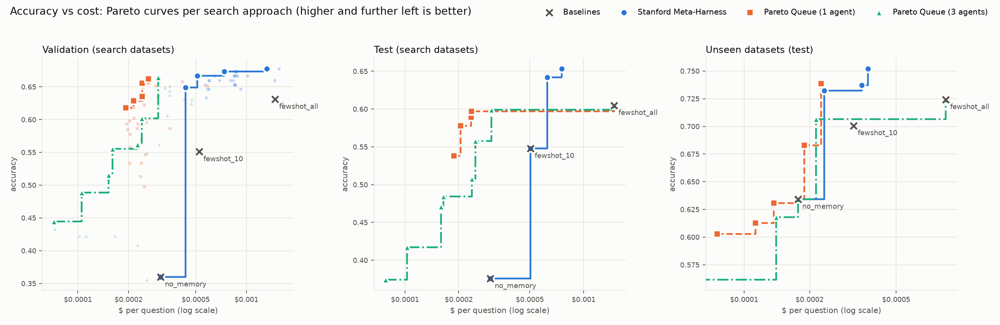
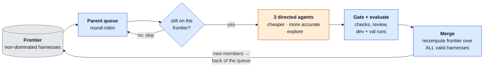

# meta-harness-pareto

**Search for a whole accuracy-vs-cost curve of LLM harnesses, not just one most-accurate harness.**

A *harness* is the code around a fixed model: what it remembers, what it puts in the prompt, how
many calls it makes. A *meta harness* uses a coding agent to write and improve harnesses
automatically. This repo builds **Pareto Queue**, a meta harness that searches for a **Pareto
frontier** of harnesses, and compares it with
[Stanford Meta-Harness](https://github.com/stanford-iris-lab/meta-harness)
([paper](https://arxiv.org/abs/2603.28052)) on the same model, data, evaluator and budget.



*Best accuracy at every price point; higher and further left is better. Test and unseen panels
use only harnesses selected on validation.*

## Why a Pareto frontier?

Scoring only accuracy rewards bigger harnesses: more calls, longer prompts, voting, often +1 point
for several times the cost. Users have budgets, so the useful output is a menu: the best harness at
every price. The two objectives are **accuracy** (exact match, averaged over datasets) and
**cost** (USD per question, all calls, including hidden reasoning tokens).

## How Pareto Queue works



One round = one dequeue:

1. **Dequeue a parent**; skip it if a newer harness has pushed it off the frontier.
2. **Write three harnesses** from it, one per direction: **cheaper**, **more accurate**,
   **explore** (a mechanism no frontier harness uses). By default three Claude Code agents run in
   parallel (`--agents 3`); with `--agents 1` one agent writes all three. Agents must first study
   the parent's failure traces and write a diagnosis.
3. **Gate and evaluate** each harness (below).
4. **Merge** into the frontier over *all* valid harnesses; new members go to the back of the queue.

Every frontier member gets a turn as a parent, so the cheap end, the accurate end and the middle of
the curve all improve. Agents see only the current frontier; dominated harnesses are dropped from
the search. Because validation is small (130 questions), differences under 2 accuracy points are
treated as noise: if the next cheaper frontier point is at least 10% cheaper, a harness must be
more than 2 points more accurate to count.

**Stanford Meta-Harness**, re-implemented on the same infrastructure for comparison: each round,
one agent reads *all* harnesses and their history and writes 3 new ones, aiming for the highest
accuracy; its curve is computed at the end. Its prompt is adapted from Stanford's skill file.
Everything else is shared, so only the search strategy differs.

## Every candidate, both approaches

Checks run cheapest first; a candidate that fails one is recorded and never costs a full evaluation:

**depth gate** (diagnosis written, traces opened) → **static rules** (one file, allowed imports, no
I/O, no dataset names) → **transcript audit** → **fake-model interface check** → **reviewer agent**
(cheating, bugs, dataset tricks) → **smoke test** (3 real questions per dataset) → **dev + val runs**.

## Data and isolation

| Split | Used for | Agents see |
|---|---|---|
| learn (75% of train) | harness learning in the dev run | raw examples |
| dev (25% of train) | dev run → per-example traces | full traces |
| val | selection | aggregate numbers only |
| test, unseen datasets (FiNER, AEGIS) | final evaluation, once | nothing |

Search datasets: USPTO, Symptom2Disease, LawBench. If agents could read the validation traces that
also pick the winners, they would learn to fix those questions instead of improving the harness.

Agents run with Claude Code **deny rules and the bash sandbox** (both are needed), work on a copy of
exactly what they may see, get no OpenAI key, and cannot edit project code. Files that name the
unseen datasets or report results (`config.yaml`, `README.md`, `results/`, `tests/`) are hidden;
the code and prompts agents can read never name them. `tests/probe_isolation.py` checks this with a
real session. Rounds are all-or-nothing: a round cut short by a usage limit, crash or Ctrl-C is
discarded, and re-running the command starts it again.

## Results

`gpt-6-luna` (medium reasoning) for every harness; Claude Code with Sonnet 5.5 (medium) for every
agent; 30 candidates (10 rounds) per run. Full tables: [`results/comparison/report.md`](results/comparison/report.md).

| | Stanford Meta-Harness | Pareto Queue (1 agent) | Pareto Queue (3 agents) |
|---|---|---|---|
| Hypervolume ×1e3: val / test / unseen | 1.24 / 1.19 / 0.81 | 1.34 / 1.22 / 0.87 | **1.39 / 1.26 / 0.88** |
| Best test accuracy | **0.653** | 0.605 | 0.605 |
| Mean val→test gap | **0.017** | 0.062 | 0.060 |
| Search cost: agents / harness model | $5.38 / $6.64 | **$4.34** / $1.66 | $6.95 / **$1.35** |

Hypervolume is the area under the curve (shared reference point); bigger is better. Search costs
count kept rounds only, at list price.

- **The search design wins the curve.** Both Pareto Queue variants beat Stanford in all three
  panels by covering the cheap end and middle, e.g. 0.597 test accuracy at $0.00024 per question
  vs $0.00062 for Stanford's cheapest new harness.
- **Three agents help only a little** (3–5% hypervolume on val/test, ~1% on unseen, likely noise)
  for ~60% more agent cost.
- **Stanford wins the accurate end and generalizes better** (3.5× smaller val→test gap).
- **Weak spot:** some cheap Pareto Queue harnesses learned the search datasets' answer formats and
  fall below `no_memory` on unseen data.

One run per configuration: an indication, not a measurement.

## Quick start

Requires Python ≥ 3.11, [uv](https://docs.astral.sh/uv/), Claude Code (`claude`) and an OpenAI key.

```bash
uv sync                                        # --group dev adds ruff + vulture
cp .env.example .env                           # set OPENAI_API_KEY
uv run python -m unittest discover -s tests    # offline tests

uv run python -m pareto.run --run stanford       --strategy stanford          --max-candidates 30
uv run python -m pareto.run --run pareto-1agent  --strategy pareto --agents 1 --max-candidates 30
uv run python -m pareto.run --run pareto-3agents --strategy pareto --agents 3 --max-candidates 30
uv run python -m pareto.finalize --runs stanford pareto-1agent pareto-3agents   # test once; locks runs
uv run python -m pareto.compare  --runs stanford pareto-1agent pareto-3agents --out results/comparison
```

Re-running `pareto.run` resumes a run; after a usage limit it exits with code 2 and resumes later.
`--rollback-to-round N` discards later rounds. Settings live in [`config.yaml`](config.yaml); verify
the `gpt-6-luna` prices there before reporting dollar figures.

## Layout

```
config.yaml       models, prices, datasets, budgets, ε margins, harness and isolation rules
pareto/           run.py (search loop) · workers.py (agents, isolation) · frontier.py · evaluate.py
                  llm.py (metered client) · checks.py · finalize.py · compare.py · prompts/ · baselines/
                  workspace_template/harness_base.py (the harness contract)
third_party/      vendored Stanford data loaders, datasets and scorers (MIT)
results/          comparison plot and report
tests/            offline tests + real-session isolation probe
runs/             (gitignored) archive, hidden val traces, agent workspaces, final results per run
```

A harness is **one Python file** with one `MemorySystem` subclass (`predict`, `learn_from_batch`,
`get_state`, `set_state`) that reaches the model only through `self.call_llm`.

## Limitations

- One run per approach; repeats are needed before drawing conclusions.
- Cheap harnesses can overfit answer formats; a hidden pass/fail check on another dataset during
  the search would catch this.
- Harness code runs unsandboxed during evaluation; static checks, the reviewer and the transcript
  audit guard against cheating, not against a malicious agent.

## Acknowledgements

[Stanford Meta-Harness](https://github.com/stanford-iris-lab/meta-harness) (task, data, scorers,
baselines, MIT) · [Karpathy's autoresearch](https://github.com/karpathy/autoresearch) (single
editable file, fixed evaluator) · the hill-climbing harness project (hidden validation, deny rules
plus sandbox, reviewer audits) · Lilian Weng,
["Harness"](https://lilianweng.github.io/posts/2026-07-04-harness/) (open problems that shaped the
design).
