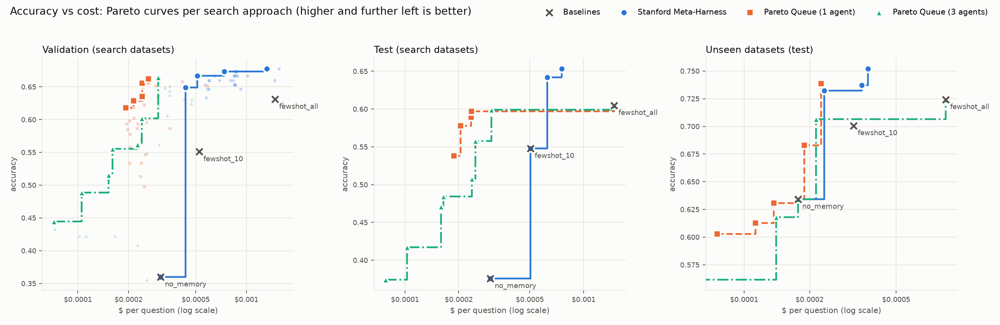

# Comparison: Stanford Meta-Harness vs Pareto Queue (1 agent) vs Pareto Queue (3 agents)

| | Stanford Meta-Harness | Pareto Queue (1 agent) | Pareto Queue (3 agents) |
|---|---|---|---|
| rounds | 10 | 10 | 10 |
| candidates proposed | 30 | 30 | 30 |
| valid candidates | 30 | 30 | 28 |
| val frontier size | 5 | 5 | 7 |
| hypervolume (val) ×1e3 | 1.241 | 1.335 | 1.392 |
| hypervolume (test) ×1e3 | 1.187 | 1.220 | 1.262 |
| hypervolume (unseen) ×1e3 | 0.813 | 0.866 | 0.878 |
| best test accuracy | 0.653 | 0.605 | 0.605 |
| mean val→test gap (selected) | 0.017 | 0.062 | 0.060 |
| search cost: coding agents (kept rounds) | $5.38 | $4.34 | $6.95 |
| search cost: harness model (kept rounds, list price) | $6.64 | $1.66 | $1.35 |
| actual spend incl. discarded rounds, cache, final eval | $9.68 | $11.69 | $8.77 |
| repeat rate vs dropped ideas | 0.27 | 0.00 | 0.00 |

Hypervolume: area dominated by the curve up to (accuracy 0, 1.5× the most expensive baseline's
cost), same reference for all runs within a panel. Test/unseen curves use only the harnesses each
run selected on validation (its val Pareto set + baselines). Repeat rate: share of candidates whose
component tags overlap (Jaccard ≥ 0.5) with an earlier harness that was off the frontier when added.

## Stanford Meta-Harness — selected harnesses

| id | name | val acc | test acc | gap | unseen acc | $/q (test) |
|---|---|---|---|---|---|---|
| b_no_memory | no_memory | 0.360 | 0.376 | -0.016 | 0.634 | 0.000301 |
| b_fewshot_10 | fewshot_10 | 0.551 | 0.548 | 0.003 | 0.701 | 0.000503 |
| h0001 | label_coverage_knn | 0.649 | 0.642 | 0.007 | 0.752 | 0.000625 |
| h0024 | retrieval_agreement_gate | 0.673 | 0.653 | 0.020 | 0.732 | 0.000755 |
| h0025 | learned_retrieval_view | 0.667 | 0.652 | 0.015 | 0.736 | 0.000784 |
| h0012 | freeform_medoid_consensus | 0.678 | 0.650 | 0.028 | 0.737 | 0.001320 |
| b_fewshot_all | fewshot_all | 0.631 | 0.605 | 0.026 | 0.724 | 0.001483 |

## Pareto Queue (1 agent) — selected harnesses

| id | name | val acc | test acc | gap | unseen acc | $/q (test) |
|---|---|---|---|---|---|---|
| h0027 | skip_top1_sim_gate | 0.618 | 0.538 | 0.080 | 0.603 | 0.000188 |
| h0028 | sim_gate_tiny_examples | 0.629 | 0.578 | 0.051 | 0.613 | 0.000205 |
| h0022 | short_examples_top3_skip | 0.656 | 0.589 | 0.066 | 0.631 | 0.000234 |
| h0014 | fewer_shorter_examples | 0.636 | 0.597 | 0.039 | 0.739 | 0.000235 |
| h0015 | unanimous_neighbor_cascade | 0.662 | 0.589 | 0.073 | 0.683 | 0.000270 |
| b_no_memory | no_memory | 0.360 | 0.376 | -0.016 | 0.634 | 0.000301 |
| b_fewshot_10 | fewshot_10 | 0.551 | 0.548 | 0.003 | 0.701 | 0.000503 |
| b_fewshot_all | fewshot_all | 0.631 | 0.605 | 0.026 | 0.724 | 0.001483 |

## Pareto Queue (3 agents) — selected harnesses

| id | name | val acc | test acc | gap | unseen acc | $/q (test) |
|---|---|---|---|---|---|---|
| h0028 | tight_think_budget | 0.444 | 0.374 | 0.070 | 0.505 | 0.000078 |
| h0030 | template_strip_centroid_vote | 0.489 | 0.417 | 0.072 | 0.561 | 0.000102 |
| h0024 | label_vocab_snap | 0.516 | 0.471 | 0.045 | 0.505 | 0.000159 |
| h0019 | quick_prompt_suffix_normalizer | 0.556 | 0.484 | 0.071 | 0.505 | 0.000164 |
| h0012 | learned_suffix_normalizer | 0.562 | 0.507 | 0.055 | 0.505 | 0.000236 |
| h0026 | knn_escalate_sorted_parts | 0.602 | 0.558 | 0.044 | 0.618 | 0.000248 |
| b_no_memory | no_memory | 0.360 | 0.376 | -0.016 | 0.634 | 0.000301 |
| h0020 | strict_knn_gate_retrieval_fewshot | 0.664 | 0.599 | 0.065 | 0.706 | 0.000304 |
| b_fewshot_10 | fewshot_10 | 0.551 | 0.548 | 0.003 | 0.701 | 0.000503 |
| b_fewshot_all | fewshot_all | 0.631 | 0.605 | 0.026 | 0.724 | 0.001483 |
